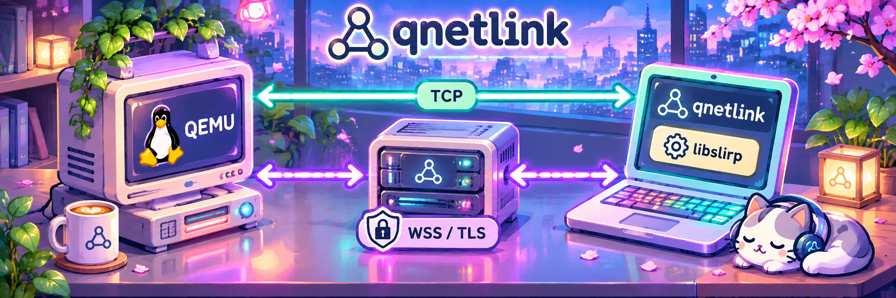

  <picture>
    <source
      media="(prefers-color-scheme: dark)"
      srcset=".github/assets/qnetlink-banner-dark.png"
    />
    
  </picture>

<pre>
qnetlink                                               November 22, 2026
Category: Product and Build Information

                           QNETLINK
             QEMU stream-based virtual machine bridge

STATUS OF THIS MEMO

   This document describes the qnetlink implementation, its
   operation, configuration, build procedures, and current limitations.
   It is project documentation, not an Internet Standards Track RFC.

ABSTRACT

   qnetlink provides user-mode networking for a QEMU guest by
   connecting a QEMU TCP stream peer to libslirp in a separate process.
   The stream can be carried directly over TCP or over WebSocket with
   TLS (WSS), allowing the network component and the QEMU endpoint to
   operate independently. This memo specifies the supported roles,
   stream framing, deployment examples, build requirements, and
   security considerations for the current implementation.

                           TABLE OF CONTENTS

   <a href="#introduction">1.  INTRODUCTION</a>
   <a href="#architecture">2.  ARCHITECTURE AND OPERATION</a>
   <a href="#roles">    2.1.  Client and Server Roles</a>
   <a href="#transport">    2.2.  Transports and Stream Framing</a>
   <a href="#usage">3.  USAGE</a>
   <a href="#configuration">4.  CONFIGURATION</a>
   <a href="#building">5.  BUILDING</a>
   <a href="#linux-build">    5.1.  Linux x86-64</a>
   <a href="#windows-build">    5.2.  Windows x86-64</a>
   <a href="#distribution">6.  DISTRIBUTION CONTENTS</a>
   <a href="#security">7.  SECURITY CONSIDERATIONS</a>
   <a href="#limitations">8.  LIMITATIONS</a>
</pre>

<pre>
qnetlink                         Product and Build Information    November 2026

1.  INTRODUCTION

   QEMU and its user-mode networking engine need not reside in the same
   process. qnetlink runs libslirp separately and bridges its
   packet traffic to a QEMU TCP stream peer. This arrangement makes the
   networking component independently executable and allows its stream
   to be transported locally over TCP or remotely over WSS.

   QEMU is launched and configured separately. qnetlink does not
   create, start, configure, or supervise virtual machines. Its purpose
   is to connect the network stream to libslirp, not to replace QEMU.

   A single executable implements two explicitly selected roles:
   --mode=client and --mode=server.

2.  ARCHITECTURE AND OPERATION

   In the direct TCP arrangement, the client runs libslirp and
   connects to a separately configured QEMU stream endpoint:

</pre>

<pre>

   In the WSS arrangement, the client reaches a server-side relay
   through a TLS-protected WebSocket connection. The server connects
   onward to the QEMU TCP stream peer:

</pre>

<pre>

   The diagrams show logical stream connections. They do not imply
   that QEMU is started by qnetlink or that the components must
   execute on distinct physical hosts.

2.1.  Client and Server Roles

   Client role

      The client operates libslirp and connects to a stream peer using
      the selected transport. Direct TCP is the default; WSS is also
      supported. The client is the component providing the user-mode
      networking engine.

   Server role

      The server accepts an incoming WSS connection and relays the
      stream to a TCP peer, normally the separately launched QEMU
      process. The server requires a TLS certificate and private key.

2.2.  Transports and Stream Framing

   The stream carries length-delimited packets. Each frame begins with
   a four-octet, unsigned, network-byte-order packet length, followed
   by that number of payload octets:

</pre>

<pre>

   Zero-length packets and packets exceeding the implementation's
   maximum packet size are rejected by the stream receiver.

   WSS transports the framed stream in WebSocket binary messages.
   Both WSS endpoints must be configured with the same WebSocket path.
   TCP and WSS are transport choices, not different guest networking
   engines.

3.  USAGE

   Direct TCP client (default transport):

       ./qnetlink --mode=client

   WSS client:

       ./qnetlink --mode=client --transport=wss \
           --stream-host=server.example --stream-port=443 --ws-path=/qemu

   WSS server:

       ./qnetlink --mode=server --listen-host=0.0.0.0 \
           --listen-port=8443 --ws-path=/qemu \
           --cert=tls/server.crt --key=tls/server.key \
           --stream-host=127.0.0.1 --stream-port=9090

   On Windows, use qnetlink.exe in place of ./qnetlink.

   Start the QEMU stream endpoint independently and ensure that its
   address and port match the stream peer configured for qnetlink.
   These commands do not start QEMU or create TLS certificates.

4.  CONFIGURATION

   The repository includes qnetlink.example.ini as a reference
   configuration. It is not loaded automatically. Copy the example,
   edit the required values, and specify the resulting file explicitly:

       ./qnetlink --config=qnetlink.ini

   Command-line options may be combined with --config. Command-line
   values take precedence over values from the configuration file.
   The role must be selected either in the file or on the command line.

   Client defaults include:

       Guest network:       10.255.254.0/24
       DHCP start:          10.255.254.15
       Stream peer:         127.0.0.1:9090
       Transport:           TCP

   Server listener defaults include:

       Listen address:      0.0.0.0 (IPv4)
       Listen port:         443

   Binding a port below 1024 on Linux may require elevated privileges
   or an appropriate system configuration.

   WSS clients verify the server certificate and hostname by default.
   See Section 7 before changing TLS verification settings.

5.  BUILDING

   The project uses Meson. Native builds require a C11 compiler,
   Meson, Ninja, pkg-config, GLib, libslirp 4.9.3 or later, and static
   libwebsockets 5.0 or later. Linux native builds also require
   OpenSSL.

   A native build can be configured and compiled with:

       meson setup build
       meson compile -C build

   The distribution scripts pin principal dependency versions and
   create build environments under .build/ and deliverables under
   dist/. The supported scripted targets are described below.

5.1.  Linux x86-64

   The Linux script builds in a Debian Bullseye amd64 environment,
   using libslirp 4.9.3 and libwebsockets 5.0.0. It strips debug
   information and checks the executable's runtime dependencies.

   Host requirements include sudo, debootstrap, curl, tar, readelf,
   sha256sum, and patch. From the project root, run:

       ./scripts/build-linux-x86_64.sh

   The environment and download cache are stored under
   .build/linux-x86_64/. The portable application directory is
   generated at dist/linux-x86_64/. Set DIST_ROOT to choose another
   output root.

   The package bundles libslirp, GLib, PCRE, OpenSSL, the executable,
   and the example INI file. Other dependencies are supplied by the
   host operating system.

5.2.  Windows x86-64

   The Windows script cross-compiles from Linux with MinGW-w64 and
   pinned MSYS2 CLANG64 runtime packages. It builds static
   libwebsockets 5.0.0 with Windows SChannel for TLS, strips debug
   information, and audits imported DLLs.

   Host requirements include Meson, Ninja, pkg-config, curl, bsdtar,
   CMake, patch, and the x86_64-w64-mingw32 GCC/binutils tools. Run:

       ./scripts/build-win64.sh

   The sysroot, dependency cache, and intermediate build are stored
   under .build/windows-x86_64/. The portable application directory
   is generated at dist/windows-x86_64/. Set DIST_ROOT to choose
   another output root.

6.  DISTRIBUTION CONTENTS

   Each build script replaces its platform output directory with the
   current build. The scripts do not create ZIP or TAR archives; the
   resulting directory can be packaged separately.

   Linux output includes qnetlink, qnetlink.example.ini, and
   a lib/ directory containing bundled runtime libraries.

   Windows output includes qnetlink.exe,
   qnetlink.example.ini, and required third-party runtime DLLs.
   Windows system DLLs are provided by Windows and are not bundled.

7.  SECURITY CONSIDERATIONS

   WSS uses TLS to protect the transport. The server requires a
   certificate and private key, and WSS clients verify the server
   certificate and hostname by default.

   The --tls-insecure option disables certificate and hostname
   verification. It is intended only for local testing with
   self-signed certificates; disabling verification removes an
   important protection against connecting to an unintended peer.

   The WSS server may be configured to listen on all IPv4 interfaces
   (0.0.0.0). Operators should consider the network exposure of the
   listener, protect private keys, and restrict access as appropriate
   for their deployment. The QEMU TCP peer must likewise be configured
   with attention to its listening address and network reachability.

   These considerations describe operational implications of the
   documented options; they do not constitute a security audit.

8.  LIMITATIONS

   The supplied distribution scripts target Linux x86-64 and Windows
   x86-64. The server currently accepts WSS connections; direct TCP
   is available as a client transport. The server handles one active
   WSS client at a time.

   QEMU startup, guest configuration, and TLS certificate creation
   are outside the scope of the build scripts. No particular QEMU
   invocation is prescribed by this memo.
</pre>
